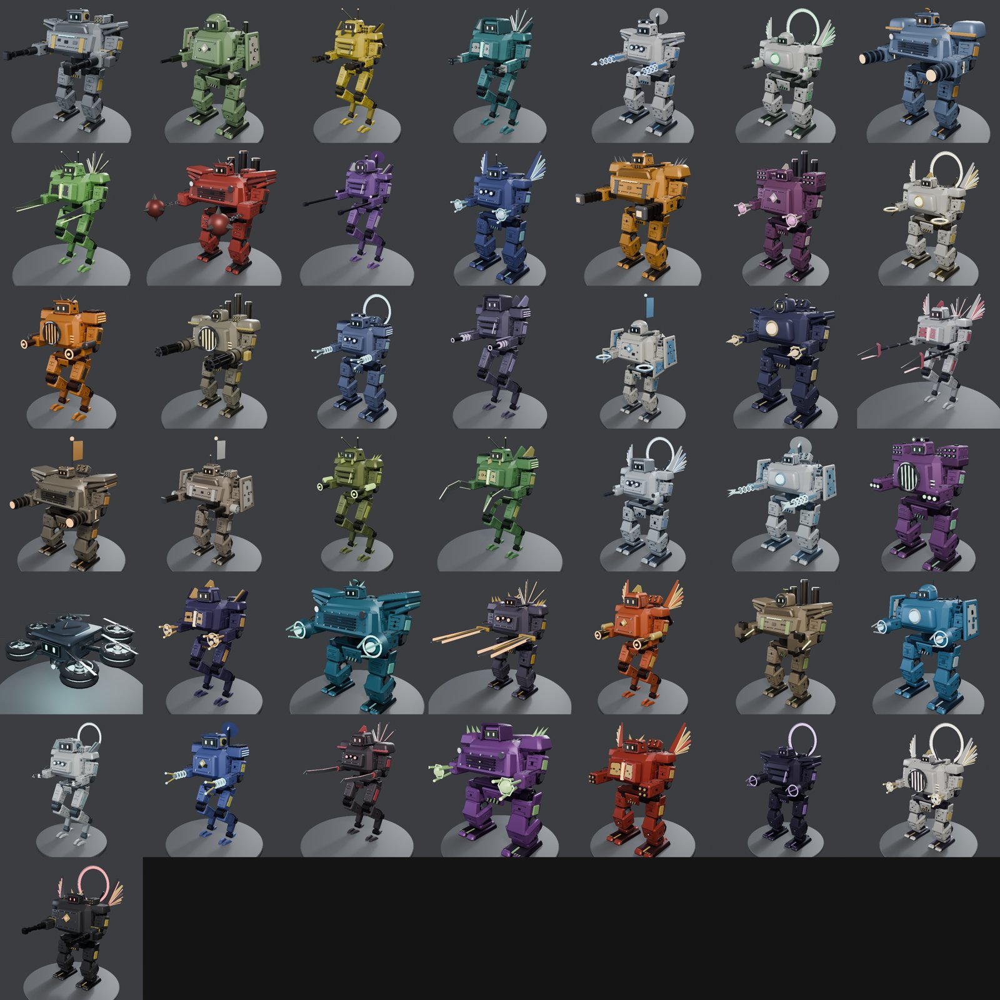
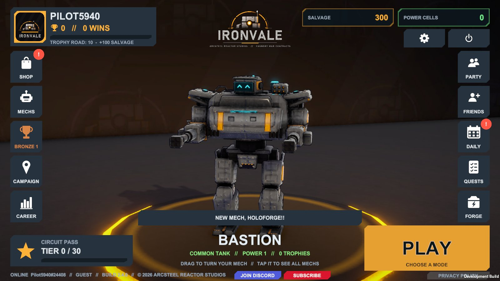
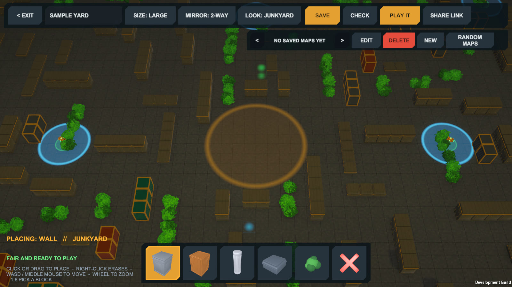
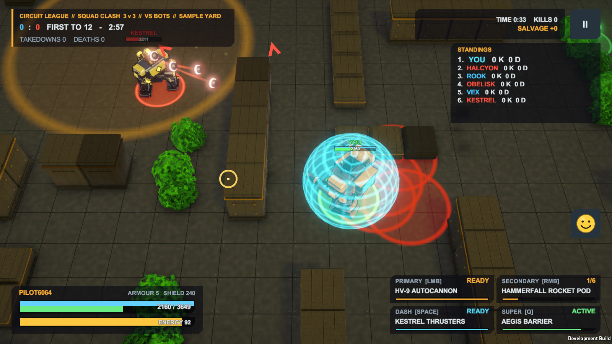

  

  
  
  
  
  
  
  
  
  
  

  
  
  
  

<b>A fast top-down mech arena brawler. Pick a combat frame, drop into the arena, and fight players on PC, phone and browser — all in the same match.</b>

---

## 🛠️ New in 2.6: Design Your Own Mech

- **Mech Designer.** Own every mech and build your own: any body, attack, heavy, dash and super, with your own name. Upgrade it, evolve it and take it online.
- **Main attacks hit 60% harder** and now use ammo that refills one round at a time, so aim matters more than holding the trigger.
- **Skill-based matchmaking**, **perks for upgrading** (power 3, 5, 7 and 9) and **easier Evolution Trial bosses**.

2.5 copies can't join 2.6 matches: update with <b>UPDATE NOW</b> or grab 2.6 from <a href="https://github.com/arcsteelreactorstudios/Ironvale/releases/latest">Releases</a>.

## 🧬 2.5: Evolution

- **Mechs evolve.** Buying gears is gone: every mech has four forms, V1 to V4, each stronger and each visible on the mech (a ring, orbiting shards, a crown). A gear you already bought counts as V2.
- **Evolution Trials.** At max power, fight four islands of echoes of your own mech, then its boss. Win, and it evolves.
- **Trials with friends.** Host a party and take a trial together, up to four pilots. Every extra pilot adds echoes and makes the trial tougher.
- **Better basic training.** The training bot starts close by, and a red arrow always points to it.

## 🔩 New in 2.4.1: All 43 Mechs Rebuilt

- **New models for every mech.** All 42 mechs and Holoforge were rebuilt in Blender with bolts, rivets, gears, hoses, vents, hazard stripes and a face screen. Holoforge is now a six-rotor drone.
- **Real metal.** Steel parts shine and reflect like metal on PC and most phones (every graphics setting except LOW; the browser version keeps the 2.4 look).
- **Better firing.** Arms kick back on every shot, barrels slide back, missile pods jolt, and missiles launch out of their own tubes with smoke.
- **More damage.** Every mech hits about 35% harder, so fights end sooner.

  2.4.0 copies can't join 2.4.1 matches: update with <b>UPDATE NOW</b> or grab 2.4.1 from <a href="https://github.com/arcsteelreactorstudios/Ironvale/releases/latest">Releases</a>.

## 🧱 New in 2.4: The Creator Update

- **Map Creator.** Build your own arena inside the real arena. Pick a block from the bar (wall, crate, pillar, low barrier, bush or eraser), then click or drag to place it. Every block is mirrored for the other side, blue rings keep spawns and pickups clear, and maps that seal an area off are refused, so every map is fair. Save up to 30 maps, then **PLAY IT** against bots, in practice or in a private room.
- **Share links.** One button copies a link to your map that opens in the browser or the app. Hosts can share a room link that joins straight in.
- **Practice.** Any mode, any mech, everyone at full level. Set how many pilots, which slots are bots (and their mechs) and which are open for friends. Nothing is won or lost.
- **Always up to date.** From 2.4 on, an old copy shows a big **DOWNLOAD NEW VERSION** screen as soon as an update is out.
- **Also new:** basic training for new pilots, lakes you can wade through in Wildlands, enterable buildings, power cube chests, new Blender-made models, better graphics and fewer stutters.

  Build it, then fight on it. 2.3 copies can't join 2.4 matches: update with <b>UPDATE NOW</b> or grab 2.4 from <a href="https://github.com/arcsteelreactorstudios/Ironvale/releases/latest">Releases</a>.

---

## 🌲 New in 2.3: Wildlands

- **Wildlands.** A 20-pilot Showdown in a 3D world seen from behind your mech, in three worlds: green Wildlands, desert Dune Sea and snowy Frostpeak. Bail out of a dropship, steer down with your jetpack, jump over cover and sneak up through the trees. Download the worlds in game (PC and Android).
- **Mechs with faces.** Face screens that blink, smile ^ ^ and react to the fight; lose and your mech breaks down with a sad face.
- **Free mechs for playing.** 15 minutes unlocks Gatling, 30 minutes unlocks Cantor Prime.
- **Bigger random maps** with breakable cover, a **party lobby** for up to 10 pilots with emotes, **voice lines** for every mech, and **LOW / DEFAULT / HIGH** graphics.
- **No minimap**, so sneak attacks work.

---

## 🎮 New in 2.2.2: Touch Controls and Difficulty

- **Modern touch controls.** Dark glass sticks and buttons with a charge arc and a glow when ready.
- **Smoother difficulty.** 10 hidden levels from easy to hard, rising with your trophies.
- **Lobby first.** New pilots start in the lobby with the tour.

---

## 🔗 New in 2.2.1: Progress Sync Fix

- **Purchases stay bought.** Progress now merges across PC, Android and browser instead of one device overwriting another. Update every device: an older copy can still overwrite your progress.
- **Link CrazyGames with your other devices.** Settings > LINK DEVICES: GET CODE on one device, LINK on the other. Do it on both for two-way sync.

---

## 🪞 New in 2.2: Holoforge, the Illusionist

- **New Legendary mech.** Projection Copy turns the enemy it hits into a hologram that fights for you, and Phantom Battalion fills the arena with 4 real and 4 fake Bastions.
- **Daily login rewards.** A 7-day calendar with a big chest on day 7.
- **Next unlock.** Every match ends by showing your next Trophy Road unlock.
- **Straight into the action.** New pilots start in a real Duel with on-screen control hints.

---

## 🧊 New in 2.1 — Squad Cubes: Power Up Together

Showdown just became a team game.

- **Shared Power Cubes.** In Duo and Trio Showdown, every cube you grab raises your **whole squad's** level and boosts every living teammate. Deaths and respawns keep the squad in step.
- **No more cap.** The 12-cube limit is gone: keep collecting and the bonuses keep stacking.
- **A cube worth chasing.** Power Cubes are now bigger, spinning, with a bright energy core and a pulsing halo.
- **Fusion picker fixed.** Every mech you own, including gifted and exclusive ones, can now be picked for Titan Fusion.
- **Settings fixed.** The list scrolls when it doesn't fit, and the bottom buttons no longer overlap.

> ⚠️ 2.0.x and 2.1 can't play online together. Press **UPDATE NOW** in game or grab 2.1 from [Releases](https://github.com/arcsteelreactorstudios/Ironvale/releases/latest).

---

## 💥 New in 2.0.2 — Heavy Metal: Every Mech Hits Harder

Fights were running long, so the whole roster just got heavier fists.

- **Every mech deals about 16% more damage.** The collection-wide damage boost goes from x1.6 to **x1.85**: attacks, heavy weapons and supers all land harder, so duels end faster and every hit counts.
- **Bastion gets a big extra punch.** On top of the global boost, Bastion's own damage goes up x1.25, **about 45% harder in total**. The starter tank is now a real threat.
- **Basic training for new pilots.** First-time players get a guided training match, a tour of the hangar and tips during their first matches.
- **Still plays with 2.0 and 2.0.1.** Mixed matches work, and the anti-cheat already allows for the new numbers. Campaign enemies are unchanged.

 Squad Clash 3v3: two takedowns in 46 seconds. Fights are faster now. Update in game with <b>UPDATE NOW</b>, or grab 2.0.2 from <a href="https://github.com/arcsteelreactorstudios/Ironvale/releases/latest">Releases</a>.

---

## 🌀 New in 2.0 — Titan Fusion & the Elemental Gauntlet

### Titan Fusion — a new 1v1 mode
Pick five of your mechs. When the match starts they gather around you, dive together and burst out as **one mega titan** that fires every attack, heavy weapon and super they carry — against an opponent who fused five of their own. First to 2 takedowns. Online and vs bots.

<table>
<tr>
<td width="50%"></td>
<td width="50%"></td>
</tr>
<tr>
<td>Your five picks circle in...</td>
<td>...dive into the centre and fuse.</td>
</tr>
<tr>
<td></td>
<td></td>
</tr>
<tr>
<td>Twice the size, one glowing orb per fused mech.</td>
<td>Titan against titan: every weapon fires at once.</td>
</tr>
</table>

 Choose your five (the first one leads: the titan takes its look and dash) and see the titan's full arsenal before you fuse.

### The Elemental Gauntlet & Aether
Own all four elemental mechs and the Gauntlet opens: mega Ignis, Terra, Maelstrom and Zephyr one after another — and when the last one falls, **Aether, the Fifth Element**, awakens with every element's power combined. You get **10 lives**. Beat it and Aether can be bought in MECHS as an **Ultra Legendary** that fires all four elemental attacks and supers alongside its own.

<table>
<tr>
<td width="50%"></td>
<td width="50%"></td>
</tr>
<tr>
<td>Five bosses in a row, 10 lives, 15 minutes.</td>
<td>Aether: Quintessence stars and four elemental orbs.</td>
</tr>
</table>

---

## 🧑‍🚀 New in 1.9 — Two New Pilots

<table>
<tr>
<td width="50%"></td>
<td width="50%"></td>
</tr>
<tr>
<td><b>Sneha, the Starweaver</b>: weaving Ribbon Stars, a Supernova Bloom heat-seeker that bursts into four, and an Oracle mega mech.</td>
<td><b>Nayra, the Mirage</b>: Mirage Daggers that speed up as they fly, a Monsoon of slowing seekers, and a Wraith mega mech.</td>
</tr>
</table>

---

## ⚒️ New in 1.8 — Forge & Fury

<table>
<tr>
<td width="50%"></td>
<td width="50%"></td>
</tr>
<tr>
<td><b>Five new mechs</b> — Jolt, Ronin, Hex, Wyvern and the Ultra Legendary <b>Oblivion</b>, whose Event Horizon beam tears through whole teams.</td>
<td><b>Forged Rewards</b> — every reward is hammered out on the anvil. Each strike can raise its rarity until it's forged.</td>
</tr>
<tr>
<td></td>
<td></td>
</tr>
<tr>
<td>Tougher frames: <b>every mech now has at least 3,500 hull</b>, and higher rarities are always tougher.</td>
<td>New soundtrack: a <b>cyberpunk phonk</b> beat in the lobby and <b>fast mecha battle music</b> in every match.</td>
</tr>
</table>

---

## 🔥 New in 1.7 — Elementals

<table>
<tr>
<td width="50%"></td>
<td width="50%"></td>
</tr>
<tr>
<td>Collect every mech to awaken the <b>four Elementals</b> — Ignis, Terra, Maelstrom and Zephyr, the toughest frames in the game.</td>
<td>Unlock each one by beating its <b>Elemental Trial</b>: a 1v1 against a towering mega titan, one life, three minutes.</td>
</tr>
<tr>
<td></td>
<td></td>
</tr>
<tr>
<td>Every mech has its own <b>gear</b>, a signature upgrade bought at max power — plus brand-new dash trails and victory poses.</td>
<td>A new <b>anti-cheat</b>: the host referees every shot, hit and move, and cheaters are removed from the match.</td>
</tr>
</table>

---

## ⚔️ The game

The Titan Circuit is an industrial ring world at war. The Ironvale Compact fights the corrupted Hollow Choir for its foundries — and every battle is fought by mechs.

- **40 mechs** across seven rarities, from Common to Ultra Legendary and Elemental — tanks, bruisers, snipers, assassins, artillery, support and skirmishers. **No two share an attack or a dash.**
- **Hidden Godly pilots** that fight on foot and summon their own mega mech.
- **Modes:** 1v1 Duel, 2v2, 3v3 team battles, Showdown, Ranked (Bronze → Godly → Unmatched) and PvE contracts.
- **Progression:** trophy road, power levels, Forged Rewards, daily quests, a season pass, skins and gears.
- **Online:** cross-play between Windows, Android and the browser, parties, friends and cloud saves.
- **Controls:** keyboard and mouse, controller, or twin-stick touch controls on phones.

<table>
<tr>
<td width="50%"></td>
<td width="50%"></td>
</tr>
<tr>
<td align="center"><i>Ragnarok, the Ultra Legendary worldsplitter</i></td>
<td align="center"><i>Collect, upgrade and gear up your frames</i></td>
</tr>
<tr>
<td></td>
<td></td>
</tr>
<tr>
<td align="center"><i>Team battles with supers and mega mechs</i></td>
<td align="center"><i>Oblivion, the Ultra Legendary void titan</i></td>
</tr>
<tr>
<td></td>
<td></td>
</tr>
<tr>
<td align="center"><i>Twin-stick touch controls on Android</i></td>
<td align="center"><i>PvE contracts in the foundry sectors</i></td>
</tr>
</table>

---

## 📥 Install

| Platform | How |
|---|---|
| **Windows** | Download [`Ironvale_Setup.exe`](https://github.com/arcsteelreactorstudios/Ironvale/releases/latest/download/Ironvale_Setup.exe) and run it. If SmartScreen appears, choose *More info → Run anyway*. |
| **Android** | Download [`Ironvale.apk`](https://github.com/arcsteelreactorstudios/Ironvale/releases/latest/download/Ironvale.apk) on your phone and open it (allow installs from your browser when asked). |
| **Browser** | [Play now](https://ironvale.gmicrosystem.com/play/) — no install. Works best in Chrome or Edge on desktop. |
| **itch.io** | [Ironvale on itch.io](https://arcsteel-reactor-studios.itch.io/ironvale) — play in the browser or grab the Windows and Android builds. |
| **Discord** | [Join the Ironvale server](https://discord.gg/ENkeWjgYFD) — patch notes, squads, bug reports and events. |
| **YouTube** | [Arcsteel Reactor Studios](https://www.youtube.com/@ArcsteelReactorStudios) — trailers, mech showcases and Shorts. |
| **TikTok** | [@arcsteelreactorstudios](https://www.tiktok.com/@arcsteelreactorstudios) — mech clips and Shorts. |
| **Instagram** | [@arcsteelreactorstudios](https://www.instagram.com/arcsteelreactorstudios) — Reels and new mech reveals. |
| **Facebook** | [Ironvale](https://www.facebook.com/profile.php?id=61596090762694) — Reels, screenshots and news. |
| **Wiki** | [Ironvale Wiki on Fandom](https://ironvale.fandom.com) — every mech, its kit and its stats. |

Already playing? The game tells you when an update is out — press **UPDATE NOW**.

## 🎮 Controls

| Action | Keyboard & mouse | Touch |
|---|---|---|
| Move | WASD | Left stick |
| Aim / attack | Mouse / left click | Right stick |
| Heavy weapon | Right click | Heavy button |
| Dash | Space | Dash button |
| Super | Q | Super button |
| Jump (Wildlands) | Space | Jump button |
| Map creator: place / erase | Left / right click | Tap / eraser |

## 🗺️ Roadmap

New mechs and arenas · seasonal content · competitive events · more PvE contracts.

See the [release notes](https://github.com/arcsteelreactorstudios/Ironvale/releases) for everything that changed in each build.

---

## ⚖️ Licence

**Ironvale is proprietary software — © 2026 Arcsteel Reactor Studios ([arcsteelreactorstudios](https://github.com/arcsteelreactorstudios)). All rights reserved.**

- ✅ Download the official builds and play them for personal, non-commercial use.
- ✅ Use the game's **art** and **names** (mechs, characters, logos, designs) in your own work, as long as you don't
  pass it off as the official game.
- ❌ Copy, re-upload, modify or decompile the game or its code, or rebrand, remake or clone it.

Read the full terms in [LICENSE.md](LICENSE.md).

## 🔒 Privacy

What the game stores and sends: [Privacy Policy](https://ironvale.gmicrosystem.com/privacy/).

---

© 2026 Arcsteel Reactor Studios. Built with Unity 6. This repository hosts the game's official builds only; the source code is private and not licensed.

